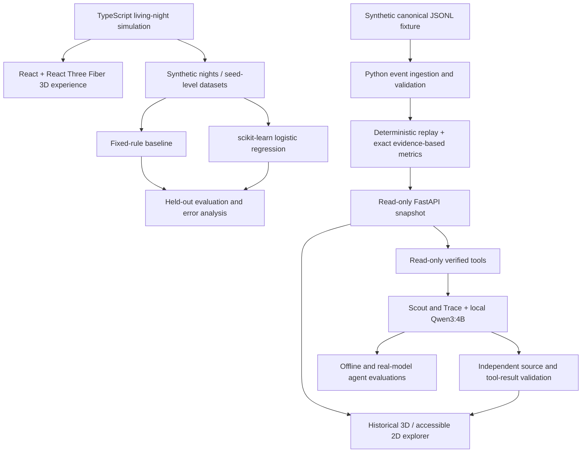

# RescueOS — The Living Restaurant

**A simulation-driven laboratory for AI engineering, delivery-risk prediction, and verifiable LLM agents.**

> **Independent educational project · Synthetic data only · Local-first**  
> A playable 3D restaurant is the interface. Underneath it, RescueOS combines a deterministic event engine, an ML experiment, and an evidence-validated agent workflow. Its main engineering question is simple: **how do we tell a convincing AI answer from a verifiable one?**

[Explore the AI Engineering case study](docs/AI_ENGINEERING_CASE.md) · [ML results](ai_lab/example_results/report.md) · [Agent integrity results](ai_lab/example_results/reliability-report-8b.md) · [Architecture](docs/ARCHITECTURE.md)

## At a glance

| Experiment / capability | Observed result | What it means |
|---|---:|---|
| Delivery-delay prediction | **F1 = 0.810** | Logistic regression on held-out synthetic simulation seeds; fixed-rule baseline: **0.698** |
| Offline agent integrity (8B) | **20/20 cases** | Controlled-provider test suite; **15/15** adversarial attempts rejected in the tested scenarios |
| Offline agent robustness (8D) | **27/27 cases** | Contract and state-validation cases using a stubbed provider, not a real LLM |
| Local Qwen3:4B evaluation (8C) | **4/4 small cases** | Scout and Trace completed the predefined checks on **one synthetic historical fixture** |

These results **do not establish production accuracy, generalization, or comprehensive security**. See [methodology, failure modes, and limitations](docs/AI_ENGINEERING_CASE.md).

## What you can explore

**1. A living, interactive restaurant.** Choose quiet, medium, or busy-night scenarios; run or pause the clock; follow synthetic orders as the kitchen prepares them and couriers collect them. Explore the scene with a 360-degree camera, interact with the original crew, and review the end-of-night summary. The simulation is deterministic for a given scenario/seed and does **not** require an LLM or backend to open.

**2. An auditable historical replay.** Open a separate mode to inspect accepted events, order states, timelines, exact metrics, and evidence from a FastAPI snapshot. Conflicting or incomplete data is shown as uncertain rather than silently converted into a definitive outcome. A 2D fallback preserves access when WebGL is unavailable.

**3. AI agents with explicit trust boundaries.** **Scout** identifies relevant alerts from a verifiable catalog; **Trace** investigates selected orders and their canonical evidence. Their local LLM workflow uses Qwen3:4B through Ollama **only after an explicit user action**. Agent suggestions cannot overwrite event-derived metrics or invent authoritative references. Other crew characters and the live-night automation are scripted simulation behaviors, **not autonomous LLM agents**.

**4. An AI Engineering Lab.** Generate datasets from the real TypeScript simulation, train and evaluate a delivery-risk classifier, test the agents against malformed or forged tool outputs, and run a deliberately small, separately identified real-model evaluation.

## Architecture



The **ML training dataset comes from the living simulation**, while the **Scout/Trace LLM evaluations use a separate historical synthetic fixture**. The two should not be mistaken for a single end-to-end live-agent benchmark.

## Run locally

### Prerequisites

- **Node.js 22+** and npm for the frontend and dataset exporter.
- **Python 3.11+** for the backend; the ML reproduction commands below use `uv` and Python 3.14.
- A browser with WebGL for the 3D scene; the historical explorer also supports a 2D fallback.
- **Ollama and `qwen3:4b` are optional** and are not needed for the playable simulation, backend replay, or offline evaluation.

### A. Play the living restaurant — no backend needed

```powershell
# Clone once, then run the frontend.
git clone https://github.com/Camper-Lingo/RescueOS.git
cd RescueOS\frontend
npm.cmd ci
npm.cmd run dev
```

Open **http://127.0.0.1:5173/**. This is the **default** entry point. Try a busy night, inspect the crew and delivery flow, then finish the shift to see the summary.

### B. Explore the historical replay and evidence

In a **second PowerShell terminal**, from the repository root:

```powershell
python -m venv .venv
.\.venv\Scripts\python.exe -m pip install -r requirements-tower.txt
.\.venv\Scripts\python.exe -B -m uvicorn rescueos.tower.api:app --host 127.0.0.1 --port 8000
```

With the frontend still running, open **http://127.0.0.1:5173/?mode=history**. For the accessible 2D rendering, use **`?mode=history&view=2d`**. API docs are available locally at **http://127.0.0.1:8000/docs**.

Scout/Trace inference is **not** automatically started by opening the app or selecting a character. It requires an explicit action and a separately configured local Ollama instance; see [Trace](docs/TRACE.md), [Scout](docs/SCOUT.md), and [real-LLM evaluation instructions](ai_lab/README_8C.md).

### C. Test the application

```powershell
# From the repository root; after backend dependencies are installed:
.\.venv\Scripts\python.exe -B -m unittest discover -s tests -q

# From the frontend directory:
cd frontend
npm.cmd test
npm.cmd run build
npx.cmd playwright test
```

End-to-end tests can start their own test server as configured in the repository. Tests are separate from real Ollama inference.

## The ML experiment: identifying late deliveries

The dataset contains **6,270 synthetic orders from 450 simulated nights**. Training and test partitions are separated by **simulation seed**, not by randomly mixing individual orders from the same run. Only completed deliveries receive a lateness label: **3,942** training deliveries and **991** test deliveries; **1,083** training and **254** test orders remained pending and were excluded from this binary target.

| Method | Precision (late) | Recall (late) | F1 (late) | Balanced accuracy |
|---|---:|---:|---:|---:|
| Fixed operational rule | **0.735** | 0.665 | 0.698 | 0.791 |
| Logistic regression | 0.721 | **0.925** | **0.810** | **0.901** |

The aggregate result is not the full story: the model scores only **0.304 F1 on medium nights**, where late deliveries are rare, versus **0.860 on busy nights**. Selection bias from excluding pending orders and synthetic-only evaluation are explicit limitations, not hidden footnotes.

Reproduce the experiment from the repository root:

```powershell
node --experimental-strip-types ai_lab/export_nights.mjs --seeds 150
uv run --python 3.14 --with scikit-learn --with joblib python ai_lab/train.py
```

The exporter creates the synthetic dataset locally. Generated datasets and trained-model artifacts are intentionally excluded from version control.

## Agent reliability: facts before fluent explanations

**Scout** searches for evidence-backed operational alerts; **Trace** retrieves and presents a selected order's event history and metrics. Both use bounded, read-only tools and compare returned values and references with canonical backend data.

The offline test suites inject controlled incorrect outputs, including a forged **999-minute** metric, invented evidence references, forbidden tools, and invalid responses. The tests measure the behavior of the **validators and agent contracts**, not the reasoning accuracy of an unconstrained LLM.

```powershell
# From repository root; no Ollama calls:
.\.venv\Scripts\python.exe -B ai_lab\reliability.py
.\.venv\Scripts\python.exe -B ai_lab\stress_suite.py
```

A separate manual evaluation ran **four Qwen3:4B cases** on a single synthetic historical fixture: Scout with and without alerts, and Trace for an on-time and a delayed order. All four met their predefined checks, but that sample is too small to imply statistical accuracy, reliable causal explanation, or robustness in real operations. Real-model execution is opt-in and documented in [AI Lab 8C](ai_lab/README_8C.md).

## Project structure

```text
frontend/    Playable simulation, React UI, 3D restaurant, unit and Playwright tests
rescueos/    Python ingest, replay, metrics, reporting, and FastAPI endpoints
ai_lab/      Dataset export, ML training, offline/real-LLM evaluations and examples
fixtures/    Canonical synthetic event fixtures
docs/        Engineering decisions, contracts, audit notes and case study
tests/       Python regression tests
```

See [the detailed case study](docs/AI_ENGINEERING_CASE.md) for numerical results, evaluation boundaries, and future experiments. The documentation in `docs/` also preserves earlier engineering milestones and decisions.

## Engineering decisions and limitations

- **Synthetic, not operational:** no live delivery platform integration, customer data, or production performance claims.
- **Read-only investigation:** canonical events drive facts; agents do not dispatch couriers or change orders.
- **Explicit evaluation boundaries:** stubbed-provider robustness is not real-model accuracy; historical LLM tests are separate from the live simulated nights.
- **Known ML weaknesses:** rare-event scenarios, unobserved pending outcomes, calibration, and out-of-distribution generalization remain open questions.
- **Local-first execution:** development servers bind to loopback. No publicly hosted demo is claimed here.

**Built as an independent AI Engineering learning and portfolio project.** Not affiliated with iFood or any delivery platform.
