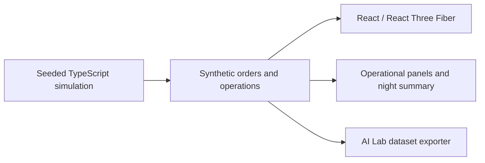
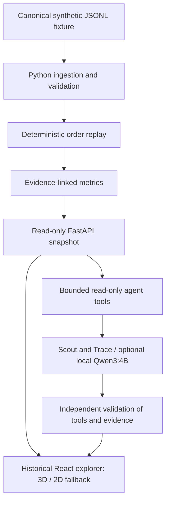
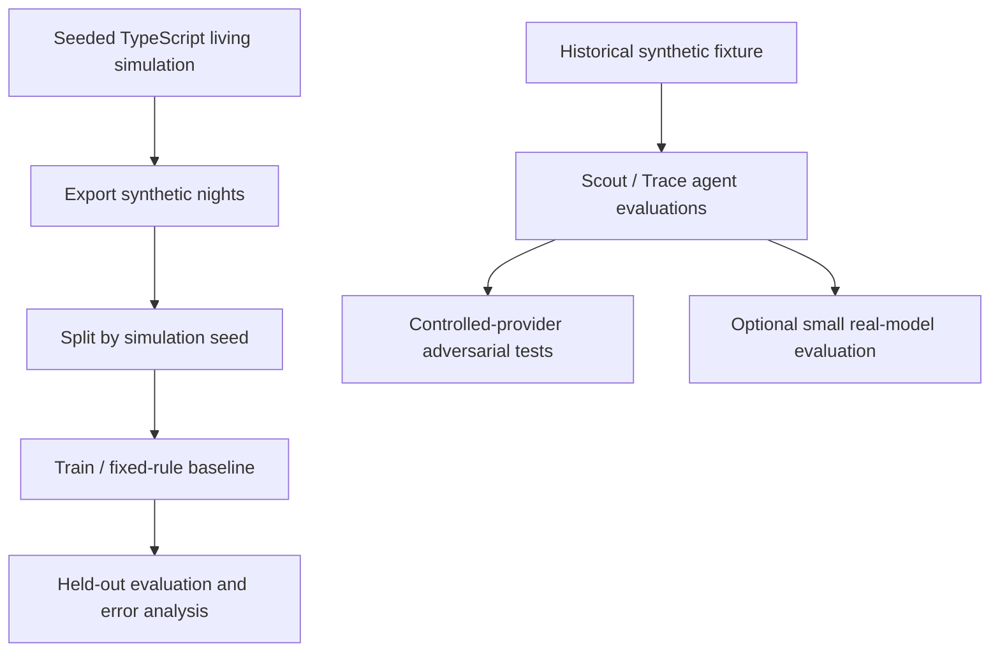

# RescueOS — Current Architecture

RescueOS is a simulation-first engineering prototype. It contains a browser-based *living restaurant*, a separate historical-event investigation workflow, and an offline AI Lab. These paths share a domain, but they do **not** form a single continuously learning production system.

## 1. Living restaurant (default browser view)

- `frontend/src/simulation/`: synthetic orders, demand scenarios, crew, couriers, and end-of-night state.
- `frontend/src/app/`: browser experience and scenario controls.
- `frontend/src/scene/`: interactive 3D restaurant and characters.
- Characters, courier movements, and simulated operational repairs follow application rules; they are **not** self-training LLM agents.
- This mode is the public static frontend demo. It requires neither Ollama nor a Python backend.

## 2. Historical event replay and read-only agents

- `rescueos/` implements contracts, ingestion, replay, metrics, and reporting. The canonical state and metrics are computed deterministically.
- `rescueos/tower/` serves a controlled historical snapshot through FastAPI and implements Scout/Trace tools and validators.
- The history view runs separately at `?mode=history` and requires the local Python backend for canonical evidence.
- Scout selects supported alerts; Trace investigates a selected order. Model output cannot forge canonical metrics or evidence. Calls to the local model are opt-in rather than automatic.
- Incomplete or contradictory records retain their uncertainty. The 2D historical fallback preserves access if WebGL is not available.

## 3. Offline AI Lab

- `ai_lab/export_nights.mjs` creates datasets based on the TypeScript simulator.
- `ai_lab/train.py` trains and evaluates a scikit-learn logistic-regression delivery-delay model; this is an **offline** operation.
- Agent reliability checks use controlled responses; separate, limited Qwen tests are explicitly labeled as real-model runs.
- The ML dataset comes from generated living nights, while the Scout/Trace tests refer to a distinct historical synthetic fixture. Do not conflate them.
- Read `docs/AI_ENGINEERING_CASE.md` and the AI Lab README files for measured outcomes, datasets, reproducibility, failure modes, and limitations.

## 4. Boundaries and potential evolution

- The publicly hosted demo is a static frontend simulation, not a production restaurant integration.
- There is no automatic retraining each time a night runs, no ingestion of live restaurant data, and no restaurant-specific deployed predictive model.
- Future integration with actual restaurant operations would require explicit data contracts, privacy and access controls, durable ingestion, quality checks, a retraining schedule, independent validation, monitoring, and safe model deployment.
- Measurements in the repository are from controlled synthetic scenarios; they do not establish business impact on real restaurants.

See also [`README.md`](../README.md), [`AI_ENGINEERING_CASE.md`](AI_ENGINEERING_CASE.md), [`SCOUT.md`](SCOUT.md), [`TRACE.md`](TRACE.md), and [`DECISIONS.md`](DECISIONS.md).
