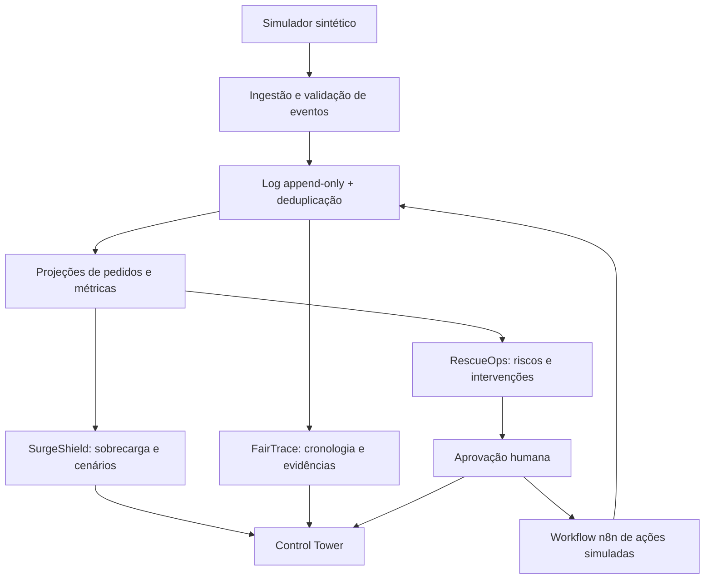

# Arquitetura evolutiva — RescueOS

## Princípio

**Uma fonte comum de eventos; três módulos especializados.** Não criar três sistemas com bases independentes: isso produziria inconsistências e retrabalho.



## Camadas

1. **Dados/eventos:** contrato versionado + armazenamento reproduzível; inicialmente JSONL, depois SQLite.
2. **Domínio determinístico:** estados, validação, atraso, fila, agregados e regras de risco.
3. **Simulação:** gera cenários controlados e replay com semente fixa; intervenção tem regras explícitas.
4. **Integrações:** API REST e n8n. MCP fornece ferramentas restritas a agentes (nunca SQL arbitrário).
5. **IA:** investigador lê evidências e propõe explicações; revisor aponta inconsistências; nenhuma ação crítica sem aprovação do sistema.
6. **Interface:** dashboard, eventos, replay, propostas, decisões e relatórios.

## Contrato de evento v0.1

Cada linha é um objeto JSON com:

```json
{
  "event_id": "evt-001",
  "order_id": "ord-1001",
  "restaurant_id": "rest-01",
  "occurred_at": "2026-10-29T18:01:00-03:00",
  "type": "ORDER_CREATED",
  "data": {
    "promised_ready_at": "2026-10-29T18:20:00-03:00",
    "promised_delivery_at": "2026-10-29T18:48:00-03:00"
  }
}
```

Eventos de restaurante que não pertencem a um pedido podem ter `order_id: null`, como `RESTAURANT_CAPACITY_UPDATED` e `PROMOTION_STARTED`. As propriedades específicas ficam em `data`. Os eventos devem ser validados por tipo; não aceitar qualquer campo arbitrário como instrução executável.

Tipos iniciais: `ORDER_CREATED`, `KITCHEN_STARTED`, `KITCHEN_READY`, `COURIER_ASSIGNED`, `COURIER_ARRIVED`, `PICKED_UP`, `DELIVERED`, `ORDER_CANCELLED`, `RESTAURANT_CAPACITY_UPDATED`, `PROMOTION_STARTED`.

## Reconstrução e integridade

- Eventos podem chegar fora de ordem; ordene por `occurred_at` e `event_id` para reproduzir a cronologia.
- Deduplicação pelo mesmo `event_id`. Se o mesmo ID vier com conteúdo diferente, tratar como conflito, não apagar silenciosamente.
- Eventos sem pedido criado vão para lista de inconsistências; não inventar pedidos.
- Estados terminais: entregue/cancelado. Eventos posteriores incompatíveis devem ser destacados para revisão.
- Eventos devem poder ser reproduzidos sem efeitos externos.
- Cada relatório aponta `event_id` e timestamp de origem das afirmações importantes.

## APIs futuras (não implementar no MVP 0)

- `POST /events` — ingestão com idempotência.
- `GET /orders` — status e filtros.
- `GET /orders/{id}/timeline` — evidências.
- `GET /risks` — alertas rastreáveis.
- `POST /simulations` — execução identificada com semente fixa.
- `POST /proposals/{id}/approve` — aprovação autenticada e validada no backend.
- `GET /evaluations` — resultados de testes e comparações.

## Ferramentas MCP futuras (não implementar no MVP 0)

`get_order_timeline`, `get_capacity_snapshot`, `list_at_risk_orders`, `get_simulation_comparison` (somente leitura). Escritas e intervenções não são permitidas pelo MCP inicial.

## Política para IA

- Números e estados são produzidos por código determinístico.
- IA resume e investiga fontes, não inventa métricas nem envia mensagens reais.
- O revisor recebe evidências e proposta, não apenas a conclusão do primeiro agente.
- Prompts não são mecanismo de permissão: backend impõe políticas.
- Limites de tempo, passos e custos registrados quando houver modelo em runtime.
- Sem dados pessoais ou credenciais reais nas fixtures.
