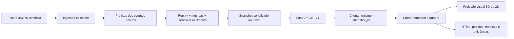

# Etapas 5A/5B — The Living Restaurant

Etapa 5A aprovada e registrada no commit `2a66164`. Polimento visual da Etapa 5B
implementado em 2026-10-30, aguardando revisão técnica e visual independente,
sem commit, push ou deploy desta etapa. Os módulos e testes das Etapas 1–4,
as fixtures e os contratos da Etapa 5A foram preservados.

## Executar no PowerShell

A instalação local foi explicitamente autorizada pelo usuário. Não é necessário
ativar a venv nem alterar a ExecutionPolicy do Windows: use os executáveis abaixo.

```powershell
Set-Location D:\rescueos_starter
# Somente para recriar um ambiente ausente, após autorização para instalar:
python -m venv .venv
.\.venv\Scripts\python.exe -m pip install -r requirements-tower.txt
Set-Location frontend
npm.cmd ci
```

Backend, em um terminal:

```powershell
Set-Location D:\rescueos_starter
.\.venv\Scripts\python.exe -B -m uvicorn rescueos.tower.api:app --host 127.0.0.1 --port 8000
```

Frontend, em outro terminal:

```powershell
Set-Location D:\rescueos_starter\frontend
npm.cmd run dev
```

Abra http://127.0.0.1:5173/; documentação HTTP em http://127.0.0.1:8000/docs.
Vite encaminha `/api` para a porta 8000. Não exponha os servidores na rede pública.
Ctrl+C encerra cada processo. A API lê a fixture uma vez no startup; reinicie o
backend para trocar o snapshot. Não há comando HTTP de escrita ou recarga.

`npm.cmd run build` faz typecheck strict e build de produção. Para conferir o build
local, mantenha o backend e execute `npm.cmd run preview`; a porta é 4173, com o
mesmo proxy `/api`. Isso é uma prévia local, não um pacote de deploy público.

## Arquitetura e contrato



`rescueos/tower/snapshot.py` chama as interfaces públicas aprovadas: `read_jsonl`,
`replay`, `compute_metrics` e **somente** `build_reports`, sem publicar arquivos.
O serializer da Etapa 4 é reutilizado em memória. O snapshot guarda textos JSON
em mapping imutável; cada resposta recebe uma cópia desserializada. O lifespan
valida os modelos de resposta antes de aceitar requisições.

| GET | Conteúdo |
| --- | --- |
| `/api/v1/health` | Prontidão e identidade do snapshot |
| `/api/v1/overview` | Agregados finais, qualidade, populações e exclusões |
| `/api/v1/orders` | Projeções finais com métricas e referências |
| `/api/v1/orders/{order_id}` | Um pedido; 404 quando inexistente |
| `/api/v1/order?order_id=...` | Consulta individual recomendada, independente de barras em paths |
| `/api/v1/diagnostics` | Diagnósticos e catálogo de evidências/origens |
| `/api/v1/replay` | Eventos ordenados e quadros temporais completos |

Todas as respostas carregam `schema_version="1.0"`, `snapshot_id` SHA-256,
`demo_mode=true` e `synthetic=true`. O cliente recusa mistura de snapshots e
versões/cenários incompatíveis. API sem upload, caminhos de arquivo remotos ou
endpoints de ações. CORS restrito aos dois nomes loopback da porta 5173; as prévias
usam o proxy de mesma origem.

Racionais HTTP são `{ "numerator": "1", "denominator": "3" }`. Ambos são strings
decimais, preservando inteiros além da precisão de Number no browser. O frontend
usa BigInt e exibe `1/3`, sem converter a fração para float. Contagens continuam
inteiros; indisponibilidade continua `null`, apresentada como “Indisponível”.
O contrato JSON publicado pela CLI da Etapa 4 não mudou.

Após a Code Review #005, todas as respostas usam uma classe JSON explícita com
`ensure_ascii=True`, `allow_nan=False` e escape de Unicode, mantendo a validação
dos response models. Isso evita a serialização direta do Pydantic que falhava
com surrogate isolado. O lifespan verifica tanto o schema quanto a serialização,
incluindo payloads individuais. Escapar muda os bytes HTTP, sem normalizar, apagar
ou substituir caracteres das identidades.

A consulta por query aceita **exatamente um** dos parâmetros `order_id` (texto
normal) e `order_id_json` (uma string codificada como JSON). Exemplo normal:
`/api/v1/order?order_id=with%2Fslash`. Para unidades UTF-16 isoladas, que não podem
ser transportadas diretamente numa URL UTF-8, use a representação JSON:
`/api/v1/order?order_id_json=%22lone-%5Cud800%22`. Parâmetros ausentes, simultâneos,
JSON inválido ou JSON de outro tipo retornam 422; pedido desconhecido, 404.

`loadOrder` no cliente usa `JSON.stringify(id)` e URLSearchParams nesta rota,
preservando barras, `?`, `#`, espaços, Unicode, emoji, combinados e surrogate.
A rota de caminho anterior continua disponível, agora também capturando barras;
para IDs arbitrários, prefira a query, pois proxies podem normalizar caminhos.
A UI temporal continua usando os quadros do bundle; uma consulta individual
retorna a projeção final e não substitui o estado de um instante anterior.

JSON com escapes de surrogate isolado é preservado por Python/JavaScript testados.
Consumidores que exijam exclusivamente valores Unicode escalares podem rejeitar
esses IDs; fontes visuais também podem exibir um glifo de substituição. A identidade
armazenada/transportada não é modificada; use o escape JSON para inspecioná-la.

Identificadores seguem a regra do núcleo Python: string com pelo menos um
caractere que `str.strip()` não remova. O cliente usa a lista explícita dos 29
whitespaces de Python 3.14/Unicode 16, sem `String.trim()`, `\s`, normalização ou
substituição. U+FEFF é conteúdo válido, inclusive cercado por espaços; U+001C–001F
e U+0085, isolados, são inválidos. Caracteres invisíveis podem produzir rótulos
visualmente vazios, mantendo sua identidade no JSON. Reavaliar a lista ao atualizar
Python/Unicode; regressões comparam os três campos de ID ao `validate_event` real.

Origens preservam nome do arquivo, linha e SHA-256 do registro bruto. O caminho
absoluto local é removido da resposta. IDs, campos e timestamps originais com
offset continuam disponíveis. Payloads arbitrários e linhas brutas não são expostos
nem executados. Textos recebidos são renderizados como texto pelo React.

## Replay e integridade

A fixture possui 20 eventos aceitos e 21 quadros: antes dos eventos e após cada
prefixo ordenado por instante UTC e event_id. Cada quadro é reconstruído pelo
**núcleo**, incluindo qualidade, elegibilidade, exclusões e métricas daquele ponto.
O frontend não reimplementa transições ou cálculos. Voltar para um quadro escolhe
a projeção correspondente; nenhum fato depende do caminho percorrido pela animação.

Auditoria e conflitos do arquivo completo são conhecidos em todos os quadros.
Variantes excluídas pela ingestão nunca
reaparecem ao voltar no tempo. Esta é uma visualização temporal de um arquivo
auditado, não uma simulação de chegada online. `applied_to_order` no catálogo de
eventos descreve a projeção final; a cena usa `applied_event_ids` **do quadro atual**.

Play/pause, reiniciar, anterior/próximo, velocidade 1×/2×/4× e slider por evento.
A reprodução a 1× comprime **1 segundo real em 5 minutos simulados**; timestamps
originais são preservados. A busca temporal inclui todos os eventos simultâneos
na ordem do backend; anterior/próximo permite visitar cada empate individualmente.
O relógio visual avança em microssegundos arredondados, sem alterar a aritmética
exata do backend. A atualização HTML é limitada a 10 Hz; animações usam refs.

O cliente trata a resposta HTTP como `unknown` até validar metadados, arrays,
objetos/estados, disponibilidade, racionais, fontes, origens e quadros. Confere
sequência, referências aos prefixos e igualdade da projeção final entre endpoints,
sem recalcular transições ou métricas. Respostas inválidas exibem erro com tentativa
de recarga e nunca são armazenadas como bundles válidos. Uma Error Boundary geral
contém falhas inesperadas de renderização e permite tentar novamente.

| Marco aplicado | Representação |
| --- | --- |
| Criação / CREATED | Pacote na entrada |
| KITCHEN_STARTED / PREPARING | Pacote na cozinha, fogão destacado |
| KITCHEN_READY / READY | Pacote no balcão de retirada |
| COURIER_ARRIVED aplicado | Runner aproxima-se da retirada para o pedido selecionado |
| PICKED_UP | Pacote na zona de despacho; Runner deixa o balcão |
| DELIVERED | Pacote com indicação de entrega na saída |
| ORDER_CANCELLED | Pacote cancelado na estação de evidências, sem atribuição de culpa |
| Ambíguo / estado ausente | Representação indeterminada na estação de evidências |
| Evidência incompleta | Cor/legenda de conclusão limitada, separada do estado reconstruído |

Eventos de capacidade/promoção ficam na timeline como contexto operacional; não
viram pedidos. Eventos desconhecidos na camada visual têm destaque neutro.
Métricas indisponíveis nunca provocam sinal de atraso calculado. Exemplo real:
em `evt-015` (18:22), ord-1002 está em preparo e a espera está indisponível; em
`evt-017` (18:34), cozinha pronta e atraso de cozinha 11; em `evt-018` (18:35),
espera 13; em `evt-020` (19:05), atraso de entrega 13.

## Cena e experiência

`RestaurantScene` integra câmera isométrica, controles orbitais limitados, luzes
quentes e sombras moderadas. `Restaurant` cria piso elevado, paredes removidas,
cozinha com fogão/coifa/panela/pratos, balcão/campainha/prateleira, portal de saída,
estação de evidências e console de operações. Plantas e luminárias são procedurais.
Não há downloads de modelos, fontes ou texturas.

O polimento 5B mantém a disposição funcional das zonas: reduz luz ambiente e
acrescenta preenchimento frio sem outra sombra dinâmica; piso quadriculado em
uma textura local, borda da plataforma, janela do forno, detalhes de coifa,
prateleira, monitor auxiliar e filetes emissivos estáticos. Scout, Trace e
Coordinator foram reposicionados para sair de trás das bancadas. Etiquetas de
zonas e pedidos não selecionados são compactas; o pedido selecionado mantém
subtítulo, contraste e anel de destaque. Os dados completos continuam no HTML.

`Monster` reutiliza geometria procedural para cinco personagens originais:

| Mascote | Identidade | Movimento/papel demonstrativo |
| --- | --- | --- |
| Scout | Ciano, antena, sensor e placa peitoral | Patrulha curta determinística; futuro SurgeShield |
| Fixer | Coral, chifres, mochila, avental e botas | Respiração mais marcada; futuro RescueOps |
| Trace | Roxo, corpo largo, lente translúcida e antena | Inclinação discreta; futuro FairTrace |
| Runner | Menta, silhueta alta, bolsa e boné | Presença/retirada conforme marcos aplicados do pedido selecionado |
| Coordinator | Azul, headset, microfone e tablet | Respiração mais lenta; nenhuma aprovação realizada |

Idle inclui respiração, pequenos saltos, piscar, orientação e movimento de pernas.
Na 5B, piscar tem transição curta, braços e pernas alternam na caminhada e os
personagens têm fases/amplitudes diferentes. Movimento reduzido aplica posições
de destino sem interpolação e interrompe os movimentos decorativos dos mascotes.
Seleção destaca o personagem. Nomes/papéis também existem em HTML. Os loops usam
o relógio da cena com fases fixas, sem aleatoriedade; fases decorativas não são
evidência de ações operacionais e não precisam voltar com o cursor de eventos.
O componente procedural pode ser substituído por um GLB licenciado no futuro,
preservando a interface de posição/seleção/redução de movimento.

Pacotes e rótulos usam apenas recursos locais. Rótulos são CanvasTexture, evitando
raízes HTML adicionais dentro do renderizador 3D. Texturas são descartadas ao
desmontar; listeners de contexto, preferências, timers e requisições são limpos.
DPR limitado a 1,5, mapa de sombra 1024 e contact shadow 256; sem física,
pós-processamento ou setState por frame. Cena carregada sob demanda.

Seleção de pedido por clique 3D e lista HTML; seleção de mascote por cena e lista;
foco de zona, visão geral, evidências por campo/linha e histórico clicável.
Loading, vazio, HTTP inválido, API offline, ID inexistente, evidência incompleta,
WebGL ausente/perdido e alternativa 2D são explícitos. Há checkbox de movimento
reduzido, inicializado e sincronizado com a preferência do sistema.

A barreira de erro da cena fica **fora** da importação lazy: falha no download ou
na renderização 3D mantém indicadores, seleção, métricas, evidências e replay no
modo 2D, com o mesmo snapshot/cursor. “Recarregar cena 3D” recarrega a página para
uma nova tentativa; esse comando reinicia a sessão visual. A reprodução temporal
e a consulta de evidências continuam disponíveis sem recarregar.

“Visão geral” emite um comando monotônico de reset, mesmo já estando selecionada.
Restaura posição `[10,11,12]`, alvo `[0,0,0]`, orientação e zoom adaptado ao viewport
`clamp(min(largura/14.2, altura/10.3), 18, 85)`. Foco em zona usa sua posição
com altura `0.35`, o mesmo deslocamento de câmera e zoom multiplicado por `1.12`
antes de limitar a 18–85. Com movimento reduzido, aplica imediatamente;
no modo normal, interpola suavemente e suspende a inércia da órbita durante o reset.

Na interface 5B, a cena ganhou espaço vertical, cores coordenadas em verde/cinza,
tipografia e contraste mais legíveis nos indicadores e evidências. Navegação de
zonas/mascotes expõe `aria-pressed`; seleção HTML, foco visível, mensagens de erro,
replay e alternativa 2D mantêm a estrutura anterior. “Snapshot carregado” descreve
a leitura local, sem sugerir uma conexão operacional em tempo real.

## Dependências e testes

Ambiente executado: Windows, Python 3.14.4, Node 24.14.1 e Chrome instalado.
API: FastAPI 0.162.0, Uvicorn 0.54.0, HTTPX 0.28.1. Dependências transitivas
instaladas fixadas em `requirements-tower.txt`; frontend fixado por package-lock.
React/DOM 19.3.1, Three 0.186.1, Fiber 9.8.2, Drei 10.7.9, Vite 8.3.5,
TypeScript 7.0.2 e Playwright 1.64.1; tipos de desenvolvimento no package.json.
Referências primárias: [instalação R3F](https://r3f.docs.pmnd.rs/getting-started/installation),
[lifespan FastAPI](https://fastapi.tiangolo.com/advanced/events/) e
[Vite](https://vite.dev/guide/).

```powershell
Set-Location D:\rescueos_starter
.\.venv\Scripts\python.exe -B -m unittest tests.test_tower_api -v
.\.venv\Scripts\python.exe -B -m unittest tests.test_tower_review005.Review005IdentifierCompatibilityTests -v
.\.venv\Scripts\python.exe -B -m unittest discover -s tests -v
git diff --check
Set-Location frontend
npm.cmd test
npm.cmd exec tsc -- --noEmit
npm.cmd run build
npm.cmd run test:e2e
# Somente regressões visuais/comportamentais da 5B:
npm.cmd run test:e2e -- e2e/stage5b.spec.ts
```

Os testes de navegador usam **Chrome já instalado**, com SwiftShader para WebGL
reproduzível em modo headless. Não instalam navegadores; sem Chrome, é preciso
aprovar/definir outro executável instalado. O Playwright inicia API/Vite quando
as portas estão livres; reutiliza os processos locais durante desenvolvimento.
Não é medição de GPU de produção nem garantia de FPS em outro computador.

Baseline antes da correção #005: 13 testes API; suíte Python com 189 casos (188 aprovados,
1 skip de symlink real por WinError 1314, já existente; mock/hardlink passaram).
12 testes Node do cliente/cursor/racionais/projeção visual. Resultados finais
do navegador e screenshots registrados no HANDOFF desta etapa.
As regressões Python de compatibilidade de IDs também exigem Node instalado:
comparam o contrato Python com o TypeScript e exercitam os clientes via HTTP local.
Starlette emite depreciação do adaptador HTTPX no TestClient; os testes passam.
A migração desse adaptador deve ser revista antes de atualizar dependências.

Validação final 5B: Python 198 casos (197 aprovados, um skip preexistente de
symlink/WinError 1314); Node 14/14; TypeScript strict e build com exit 0;
Playwright 24/24, incluindo os 21 anteriores. Os três testes novos verificam
transformações reais dos cinco mascotes, imobilidade com movimento reduzido,
seleção HTML, foco/zoom e reset repetido da câmera após interação manual, além
da posição do Runner nos quadros 14, 15 e 18 e ao voltar ao 14. O teste de câmera
aguarda o zoom calculado para o viewport antes de capturar a referência, sem
confundir a interpolação de entrada com a posição de repouso.

Capturas comparáveis em `out/stage5b-before-{desktop,evidence,mobile-3d,mobile-2d}.png`
e `out/stage5b-after-{desktop,evidence,mobile-3d,mobile-2d}.png`. Capturas adicionais
mostram cozinha, replay no quadro 15 e alternativa 2D desktop. Todos são artefatos
locais ignorados pelo Git. O diff completo, incluindo o teste novo não rastreado,
fica em `out/stage5b-review.diff`.

Medição exploratória: Chrome 156.0.8078.74 headless/SwiftShader, um browser por
execução, viewports 1440×1080 e 390×844, movimento normal, aquecimento de 1,8 s e
45 intervalos de requestAnimationFrame após descartar o primeiro. A leitura do
renderer passou de 280 para 308 draw calls e de 101.046 para 119.464 triângulos;
geometrias de 178 para 195 e texturas de 12 para 13. Nenhum mapa de sombra novo.

| Mediana / p95 dos intervalos (ms) | Antes | Depois | Depois com Canvas nas dimensões anteriores |
| --- | --- | --- | --- |
| Desktop | 99,9 / 100,1 | 150,0 / 166,6 | 116,7 / 133,3 |
| Mobile emulado | 50,0 / 66,7 | 66,7 / 83,3 | 83,3 / 83,4 |

Canvas desktop mudou de 1016×488 para 1004×560; mobile de 360×360 para 360×320.
A última coluna mantém 1016×488/360×360 por CSS
temporário, sem mudar o produto. Arquivos `out/stage5b-performance-before.json`,
`-after.json` e `-same-canvas.json` registram os valores brutos. Há custo gráfico
adicional e variação entre amostras; estes intervalos em renderização por software
não são tempo de GPU nem certificação de FPS. Homologar em GPU/dispositivo modesto
real antes de prometer fluidez. Fallback 2D e movimento reduzido continuam disponíveis.

## Limitações e próxima revisão

- Fixture pequena e fixa em memória. Prefixos completos tornam o preparo e o
  payload de replay quadráticos no número de eventos; não é um mecanismo de
  streaming nem adequado a logs grandes. Definir paginação/checkpoints/limites
  antes de aceitar entradas externas.
- A representação é esquemática, com um Runner para o pedido selecionado;
  posições/caminhos decorativos não representam coordenadas ou tempos de viagem
  reais. Rótulos podem se aproximar, especialmente na retirada; podem cobrir parte
  do Runner nesse marco e em zooms/ângulos extremos. HTML é a alternativa
  de consulta e seleção. Nenhuma meta de FPS foi certificada.
- Só Chrome/Windows foi executado nesta entrega; outros browsers/GPUs e recursos
  assistivos precisam de homologação. Não é uma auditoria completa de acessibilidade.
- Sem autenticação de produção, banco, uploads, ações, agentes, MCP, n8n, WebSockets
  ou deploy. Servidores destinados apenas ao uso local com fixture sintética.
- Snapshot é consistente dentro deste processo. Múltiplos workers podem carregar
  versões diferentes caso o arquivo mude; não há recarga/coordenador de versões.
- A API não consome nem publica relatórios no disco. Limites de publicação da
  Etapa 4 continuam explícitos: sem transação do trio ou escritores concorrentes.
  Antes de concorrência, adicionar lock/coordenador de escritores e publicação
  de geração imutável com ponteiro/manifesto transacional e recuperação testada.
- Revisão independente deve conferir particularmente o contrato HTTP de racionais,
  a auditoria estática nos quadros, marcos aplicados e indisponibilidade temporal.
